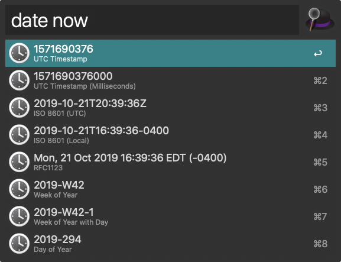
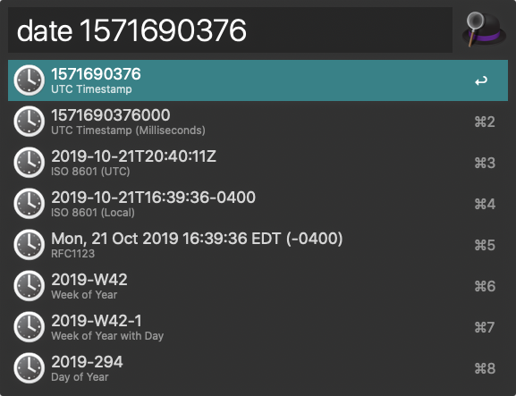

# alfred-datetime-format-converter

Alfred 5 workflow for converting between timestamps and formatted datetime strings with ease.

Simply type "date" followed by: "now", a UTC unix timestamp, or a formatted datetime string.

This will present you with the parsed date in various formats ready to copy to your clipboard.

[Download Latest Release](https://github.com/jnovack/alfred-datetime-format-converter/releases/latest/download/DatetimeFormatConverter.alfredworkflow)

[Alfred Forum Topic](http://www.alfredforum.com/topic/1558-datetime-format-converter-convert-between-unix-timestamps-and-datetime-strings/)

## Credits

- https://github.com/mwaterfall/

## Build and Release

- Build locally: `make build`
- Output package: `dist/DatetimeFormatConverter.alfredworkflow`
- CI packaging runs on every PR and `main` push and uploads the package as a workflow artifact.
- To publish a downloadable release asset, push a [semver](https://semver.org)-valid tag (e.g. `v0.5-rc.1`); GitHub Actions attaches the package to that GitHub Release.
